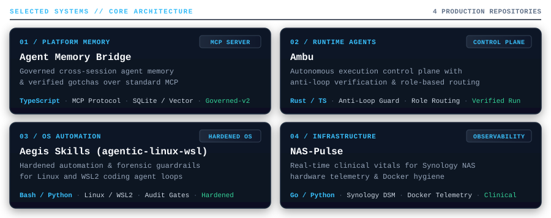
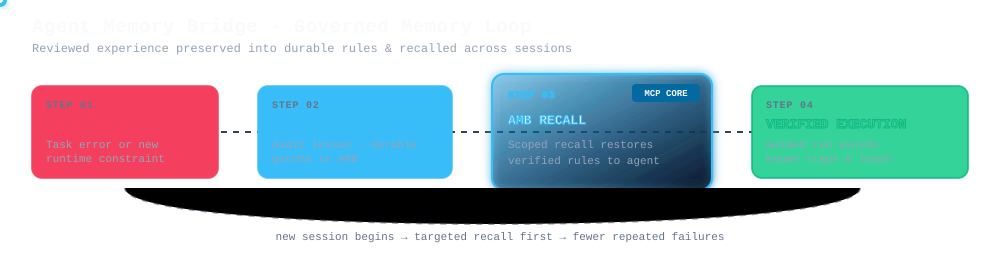

<!-- Animated Terminal Hero -->

  <picture>
    <source media="(prefers-color-scheme: dark)" srcset="./assets/terminal-hero-dark.svg" />
    <source media="(prefers-color-scheme: light)" srcset="./assets/terminal-hero-light.svg" />
    
  </picture>

  <a href="https://www.frankzhang.ca/"><strong>frankzhang.ca</strong></a> &nbsp;·&nbsp;
  <a href="https://github.com/zzhang82?tab=repositories"><strong>Repositories</strong></a> &nbsp;·&nbsp;
  <a href="https://github.com/zzhang82/Agent-Memory-Bridge"><strong>Agent Memory Bridge</strong></a> &nbsp;·&nbsp;
  Toronto, ON

---

### Selected Systems

<!-- Visual Project Showcase -->

  <picture>
    <source media="(prefers-color-scheme: dark)" srcset="./assets/project-showcase-dark.svg" />
    <source media="(prefers-color-scheme: light)" srcset="./assets/project-showcase-light.svg" />
    
  </picture>

<!-- Interactive Markdown Fallback & Direct Navigation -->
| System | Domain | Architecture & Highlights |
| :--- | :--- | :--- |
| **[Agent Memory Bridge](https://github.com/zzhang82/Agent-Memory-Bridge)** | Platform Memory | Governed cross-session agent memory, auditable gotchas, and dual-lane memory/signals over standard Model Context Protocol (MCP). |
| **[Ambu](https://github.com/zzhang82/ambu-runtime-agents)** | Runtime Agents | Autonomous execution control plane with anti-loop verification, role-based routing, and bounded repair workflows. |
| **[Aegis Skills](https://github.com/zzhang82/agentic-linux-wsl-kit)** | OS Automation & Security | Hardened automation skills, forensic guardrails, and environment hygiene for Linux and WSL2 coding-agent loops. |
| **[NAS-Pulse](https://github.com/zzhang82/nas-pulse)** | Infrastructure Observability | Real-time clinical diagnostic tooling for Synology NAS hardware vitals, drive telemetry, and Docker container hygiene. |

---

### Governed Memory Architecture

> *AI agents operate reliably when reviewed experience is preserved into durable, auditable memory rather than relying on ephemeral chat context or continuous retraining.*

  <a href="https://github.com/zzhang82/Agent-Memory-Bridge">
    <picture>
      <source media="(prefers-color-scheme: dark)" srcset="./assets/amb-learning-loop-dark.svg" />
      <source media="(prefers-color-scheme: light)" srcset="./assets/amb-learning-loop-light.svg" />
      
    </picture>
  </a>

---

### Engineering Activity

  <picture>
    <source media="(prefers-color-scheme: dark)" srcset="https://raw.githubusercontent.com/zzhang82/zzhang82/output/github-contribution-grid-snake-dark.svg" />
    <source media="(prefers-color-scheme: light)" srcset="https://raw.githubusercontent.com/zzhang82/zzhang82/output/github-contribution-grid-snake.svg" />
    
  </picture>

